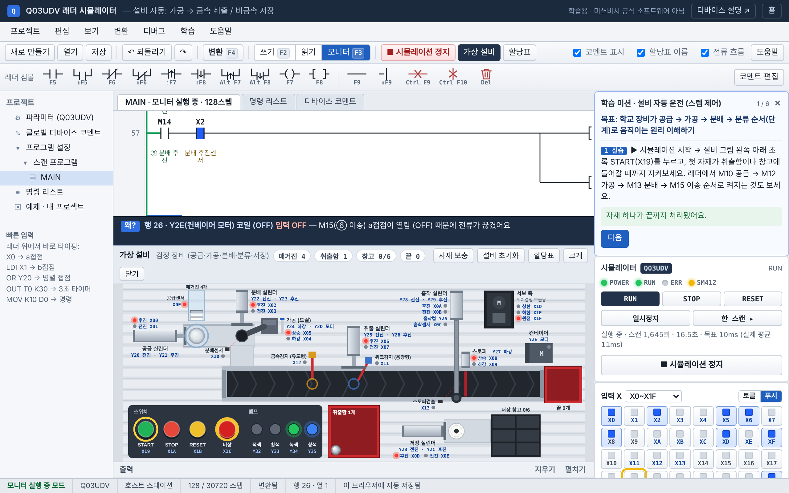

# Q03UDV 래더 시뮬레이터

GX Works2처럼 래더를 짜고, 브라우저에서 바로 돌려보는 미쓰비시 Q03UDV PLC 연습 사이트.

**사이트:** https://ljh30581712-beep.github.io/plc-ladder-sim/

## 페이지

| 파일 | 내용 |
|---|---|
| `index.html` | 메인 소개 페이지 |
| `simulator.html` | 래더 편집기 + 시뮬레이터 + 가상 설비 + 학습 미션 |
| `devices.html` | 디바이스 설명 (X, Y, M, T, C, D, SM, K, H, KnY) + 번호 해석기 |
| `io.html` | 검정 장비 입출력 할당표 (X00~X1F, Y20~Y3F) — 찾기, 인쇄, 실린더별 센서·솔레노이드 짝 |

## 기능

- **래더 입력:** GX Works2와 같은 단축키 (F5 a접점, F6 b접점, F7 코일, F8 응용명령, F9 가로선, Shift+F9 세로선)
- **변환(F4):** 회로 오류를 검사하고 명령 리스트(LD, AND, OR, ANB, ORB, MPS …)를 만듦
- **시뮬레이션:** X 입력 스위치, Y 출력 램프, 타이머·카운터 현재값, 디바이스 모니터, 일시정지 / 한 스캔 실행
- **가상 설비:** 학교 검정 장비(생산자동화 실습 장치 CT-4200M) 모양 — 매거진 → 공급 → 드릴 가공 → 분배 → 컨베이어 → 금속 취출 / 스토퍼 → 흡착 → 저장 창고. 입출력 번호는 검정 장비 할당표 그대로이고, 더블 솔레노이드 밸브는 마지막 방향을 기억하고 싱글은 끄면 돌아옴
- **예제 10개 모두 학교 장비 번호:** START `X19` · STOP `X1A` · RESET `X1B` · 워크감지 `X11` · 컨베이어 `Y2E` · 공급 Sol `Y20`/`Y21` · 램프 `Y32`~`Y35`처럼 검정 장비 할당표에 있는 번호만 씀
- **입출력 할당표:** 시뮬레이터 오른쪽 카드에서 찾기·켜짐 표시, 줄을 누르면 래더 입력칸에 들어감. 코멘트를 안 쓴 X·Y 아래에는 할당표 이름(START, 공급 후진센서 …)이 자동으로 보임
- **학습 미션 4개:** 자기유지 · 타이머 · 카운터 · 설비 자동 운전(스텝 제어). 목표 → 결과 예상 → 직접 수정 → 결과 확인 → 정리 순서로 진행하고, 결과는 자동으로 판정. 지금 눌러야 할 버튼을 노랗게 표시하고, 끝낸 미션은 ✓로 기록
- **"왜?" 원인 설명:** 모니터 중 커서 줄의 출력이 켜진 전류 길이나, 꺼지게 만든 접점을 문장으로 보여줌
- **변화 기록:** X·Y·M·T·C가 바뀐 순서를 시간과 함께 기록
- **저장:** 브라우저 자동 저장, 예제·파일을 열기 전 하던 작업 자동 백업(최근 5개), .json 내보내기/불러오기(설비 입출력 번호 포함)
- **예제 회로 10개:** `simulator.html#ex-1` ~ `#ex-10`으로 바로 열기, 빈 프로젝트는 `simulator.html#new`
- **휴대폰·태블릿:** 칸을 한 번 누르면 선택, 같은 칸을 한 번 더 누르면 입력(모니터 중에는 ON/OFF), 툴바의 삭제 버튼

## 검증

시뮬레이터의 **학습 → 동작 자가 검사**를 누르면 아래 95개 항목을 정해진 입력으로 자동 실행해 결과를 보여 줍니다.

| 분류 | 항목 수 | 내용 |
|---|---|---|
| 입력 문법 | 44 | 안내 페이지·도움말에 나오는 명령 39개가 입력되는지, 잘못된 입력 5개에 오류를 알려주는지 |
| 래더 변환 | 15 | 예제 10개 변환, OR·MPS/MPP·ANB·ORB 명령 생성, 출력 없는 회로 오류 |
| 동작 | 24 | 자기유지, 인터록, 타이머(2.9초 OFF / 3초 ON, 설정값을 바꾸면 이어서 셈), 플리커, 카운터, 신호등 순서, 데이터 처리, ALTP, 0으로 나누기 오류(4100) |
| 가상 설비 | 11 | 할당표 번호·찾기, 기초 예제(공급 → 분배 → 끝 상자), 자동 예제(금속 2개 → 취출함, 흰색 2개 → 흡착 → 창고, 드릴 가공 여부), STOP 때 컨베이어가 멈추고 단계를 기억하는지, START로 이어서 저장까지 가는지, 더블 솔레노이드가 짧은 출력에도 끝까지 가는지, 드릴 모터 없이 내리면 하강센서가 안 켜지는지 |
| 화면 | 1 | 변화 기록이 400개를 넘어도 새 기록이 화면에 갱신되는지 |

실제 PLC와 다르게 단순화한 부분은 **학습 → 시뮬레이터 지원 범위**에 정리했습니다. (예: 스캔 주기는 목표 10ms이고 브라우저에 따라 달라짐, 탭을 가리면 PLC와 설비 시간이 같이 멈춤)

## 개발 과정

AI 도구(Claude)에게 기능을 요청하고, 결과를 직접 써 보면서 다음 요청을 정하는 방식으로 만들었습니다.

| 단계 | 요청한 것 | 결과 |
|---|---|---|
| 1 | GX Works2처럼 래더를 작성하고 시뮬레이션까지 해 보는 프로그램 | 래더 편집기, 변환, 가상 CPU, 모니터, I/O 패널 |
| 2 | 사이트로 만들기, Y1 같은 디바이스 뜻을 설명하는 페이지 | 메인 페이지, 디바이스 설명 페이지, GitHub Pages 배포 |
| 3 | GX Works2를 따라 만들어도 법적 문제가 없는지 | 저작권·상표 기준 확인, 코드와 그림을 직접 만들고 "공식 소프트웨어 아님" 표기 |
| 4 | 학교 실습 장비 사진을 보여 주고, 이런 장비가 움직이는 걸 보고 싶다고 요청 | 가상 설비와 설비 예제 2개 |
| 5 | 공개 코드 검토 의견 7가지를 바탕으로 보완 | 작업 자동 백업, 설비 I/O 저장, 비교 명령 문법 통일, PLC·설비 시간 기준 통일, 학습 미션, 원인 설명·변화 기록, 자동 자가 검사 |
| 6 | 2차 검토 의견 3가지(정지 동작, 타이머 미션 막힘, 변화 기록 갱신)를 바탕으로 보완 | PB3 정지 = 그 자리에서 멈추고 PB1로 이어서, 타이머 미션 안내 순서와 현재 상태 표시, 이벤트 번호로 화면 갱신. 재현 테스트 중 컨베이어 끝 자재가 치워지지 않는 문제를 추가로 찾아 수정 |
| 7 | 친구가 설명 없이 끝까지 할 수 있게 다듬기 | 설비 자동 분류(스텝 제어) 미션 추가, 지금 누를 버튼 강조, 끝낸 미션 ✓ 기록과 다음 미션 버튼, 휴대폰 터치 입력·삭제 버튼, 빈 프로젝트 링크, GX Works2 고유 표기 정리, 스크롤 때 입력창이 닫히던 문제 수정 |
| 8 | 학교 장비와 시뮬레이션이 다르다며 장비 사진과 입출력 할당표 사진을 찍어 와서, 똑같이 만들고 할당표를 사이트에서 볼 수 있게 요청 | 가상 설비를 검정 장비 구성(공급·가공·분배·취출·스토퍼·흡착·저장·서보 축·스위치·램프)과 할당표 번호로 다시 만듦, 더블/싱글 솔레노이드 동작 구분, 시뮬레이터 할당표 카드와 자동 코멘트, 인쇄용 할당표 페이지, 설비 예제·미션·자가 검사 갱신 |
| 9 | 예제에서 X0·X1이 아직 PB(푸시버튼)로 나온다며 할당표대로 전부 바꾸고 더블체크 요청 | 예제 1~8, 미션 1~3, 입력 힌트·도움말, 메인·디바이스 페이지 예시를 할당표 번호로 교체 (X0·X1 → X19 START·X1A STOP 등), 디바이스 해석기에 검정 장비 이름 표시, 할당표 대조 자동 검사 추가 |

## 참고

PLC 수업 연습용 프로젝트입니다. 미쓰비시전기의 공식 소프트웨어가 아니며, GX Works2·MELSEC은 미쓰비시전기의 상표입니다.
